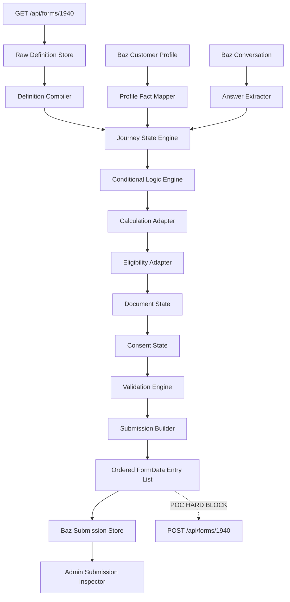

# Baz — Personal Loan Digital Forms Journey (Form 1940)

**Document type:** Development definition / POC implementation specification  
**Journey:** Personal Loan  
**Digital Forms form ID:** `1940`  
**Observed source form:** `Consumer Loans E2E Combined - R9.10.1`  
**Customer journey:** `https://digital.bankofireland.com/consumer-lending/personal-loan`  
**Definition:** `GET https://digital.bankofireland.com/api/forms/1940`  
**Submission:** `POST https://digital.bankofireland.com/api/forms/1940`  
**Observed transport:** browser `FormData` (`multipart/form-data`)  
**Observed captured branch:** 74 FormData entries  
**POC rule:** generate and inspect the submission package; **do not send it to Bank of Ireland**.

---

## 1. Objective

This feature extends the Baz Digital Forms integration from SuperSaver (`1833`) to a materially more complex Personal Loan journey (`1940`).

The purpose is to prove that Baz does not need a bespoke, hand-authored conversational flow for every Bank of Ireland product. Instead, Baz should consume the same machine-readable Digital Forms definition used by the existing digital journey, determine the active path, collect or reuse the required information, evaluate deterministic journey state, and generate the same submission structure expected by the existing platform.

The core proposition is:

> **Baz is another renderer and orchestrator of the existing Digital Forms journey contract.**

For Personal Loan, this is a stronger proof than SuperSaver because the form definition includes not only questions and branching, but also calculated fields, quote/affordability controls, eligibility state, document-upload state and explicit consent.

---

## 2. Existing platform behaviour

The observed flow is:

```text
Customer opens
https://digital.bankofireland.com/consumer-lending/personal-loan

        ↓

GET /api/forms/1940

        ↓

Digital Forms definition
- fields and component types
- labels / choices / values
- default values
- conditional logic
- calculated fields
- NDI calculation controls
- eligibility controls
- document requirements
- consent controls
- nonce/runtime metadata

        ↓

Existing web renderer

        ↓

Customer completes the active branch

        ↓

POST /api/forms/1940
FormData / multipart-form-data
```

The same resource therefore behaves as both the definition and submission contract:

```text
GET  /api/forms/{formId}  → journey definition
POST /api/forms/{formId}  → completed journey state
```

---

## 3. Source definition

The supplied definition contains **418 field/control objects** and identifies the form as:

```json
{
  "title": "Consumer Loans E2E Combined - R9.10.1",
  "button": {
    "text": "Submit application"
  }
}
```

The `fields` collection contains a mixture of:

- customer-answer fields;
- pages, sections and HTML content;
- hidden/default fields;
- conditional branch markers;
- calculated values;
- quote calculators;
- affordability/eligibility controls;
- file-upload and preview controls;
- explicit consent controls.

Baz must compile the definition into an internal journey model. It must not treat every definition object as a question.

---

## 4. Captured branch

The captured POST represents one Personal Loan route with the following high-level state:

```text
Applicant type          Private Individual
Product                 Personal Loan
Student                 No
Loan type               New loan
Purpose                 Car purchase
Repayment frequency     Monthly
Payment deferral        No
Repayment term          24 months
Marital status          Single
Living arrangements     Home
Dependants              0
Eligibility result      eligible
Document state          uploaded / previewing
```

All personally identifying and financial values are redacted in this document.

The important engineering fact is that the definition has 418 possible objects, while this resolved path serialized to **74 FormData entries**. The final POST is therefore the active journey state, not a copy of the complete definition.

---

## 5. Product selection and amount

Key source fields include:

```text
363  Are you a student?
207  Choose a loan
500  What is the purpose of your loan?
179  How much do you want to borrow?
255  Total amount
```

The captured branch serializes these as:

```text
input_363 = "No"
input_207 = "New loan"
input_500 = "Car purchase"
input_179 = "<loan-amount>"
input_255 = "<loan-amount>"
```

Field `255` is not a customer question. Its source definition contains a calculation formula combining the possible loan amount fields:

```text
{:179}+{:218}+{:219}+{:381}+{:396}+{:453}+{:501}
```

Baz must derive this value deterministically from the active branch rather than asking for it conversationally.

---

## 6. NDI quote, affordability and eligibility controls

Form `1940` contains custom `ndi_*` controls. These are important because they prove the source journey describes decision machinery as well as data capture.

### 6.1 Simulated repayments — field 231

```text
type: ndi_simulate_repayments
label: Simulated Repayments Calculator
```

The captured POST contains:

```text
input_231.parameters
input_231.result
```

The browser inspector displayed each as `[object Object]`. Treat that as the observed wire representation only; do not assume it is the complete underlying calculation contract.

### 6.2 Quick quote — field 235

Field `235` is an `ndi_calculator` used for the quick quote. Its definition references values such as loan amount, term, loan type, repayment frequency and moratorium/defer state.

Captured POST:

```text
input_235.parameters
input_235.result
```

### 6.3 Full quote / affordability — field 238

Field `238` is the full quote calculation. The definition references inputs including:

- loan amount;
- repayment term;
- net salary;
- marital status;
- living arrangements;
- number of dependants;
- monthly rent/mortgage payments;
- credit-card balance;
- other monthly loan repayments;
- second-applicant values where applicable.

Captured POST:

```text
input_238.parameters
input_238.result
```

### 6.4 Eligibility — field 239

Field `239` is an `ndi_eligibility` control tied to calculation `238`.

Captured result:

```text
input_239 = "eligible"
```

### Development rule

> **The LLM can explain a calculation or eligibility result. It must not invent one.**

For the POC, each NDI component must declare one of three states:

```text
SOURCE_FAITHFUL    real deterministic implementation
FIXTURE            captured/synthetic demo result
UNSUPPORTED        journey cannot proceed through that component
```

Never silently use the LLM as a substitute for lending/affordability logic.

---

## 7. Reusing Baz customer facts

The Personal Loan journey requests many facts that can exist independently of the loan product:

- name;
- contact details;
- residency/citizenship;
- employment sector;
- occupation;
- employer;
- time at address;
- time in role;
- income;
- housing cost;
- existing credit commitments;
- savings;
- source of funds/wealth.

These should remain semantic customer facts in Baz and be mapped into the form as needed.

Example:

```text
Baz profile
customer.identity.firstName

        ↓ form mapping

1940 field 203

        ↓ serializer

input_203
```

This is deliberately separate from another product's field IDs. A SuperSaver journey might map the same fact to a different Digital Forms field.

The customer profile is canonical; form IDs are adapters.

---

## 8. Compound fields

The captured submission confirms compound controls that serialize into multiple FormData entries.

For example:

```text
input_443.1
input_443.2
input_443.3

input_444.1
input_444.2
input_444.3
```

These correspond to duration-style controls such as time at address / time in role.

Baz should store the semantic value:

```json
{
  "years": 5,
  "months": 10
}
```

and allow a deterministic serializer to create the component-specific POST structure:

```text
input_443.1 = "5"
input_443.2 = "10"
input_443.3 = "70"
```

The LLM extracts meaning; the serializer owns the transport representation.

---

## 9. Document upload

The source definition contains:

```text
field 151
  type: fileupload
  toscana: PPSN_Document
  maxFileSize: 2
  maxFiles: 1
  extensions: jpg, png, jpeg, pdf

field 436
  type: file_preview
  fileFields: ["input_151"]
```

The final POST did not carry the document bytes directly as `input_151`. It instead included upload state:

```text
input_436 = "previewing"

gform_uploaded_files = {
  "input_151": [
    {
      "temp_filename": "...",
      "uploaded_filename": "...",
      "x-file-hash": "...",
      "x-signed-file-hash": "..."
    }
  ]
}
```

This strongly suggests a two-stage flow:

```text
upload document
    ↓
receive temporary upload metadata
    ↓
retain reference against input_151
    ↓
include upload manifest in final POST
```

### POC behaviour

Baz should not fabricate production file hashes or signed hashes.

For the POC:

1. store a synthetic/demo document in Baz storage;
2. record the intended mapping to field `151`;
3. create an inspection-only document reference;
4. show the production Digital Forms upload integration as a separate future adapter.

---

## 10. Explicit consent

The captured POST contains explicit checkbox entries including:

```text
input_48.1  = "Yes"
input_49.1  = "Yes"
input_200.1 = "Yes"
input_201.1 = "Yes"
input_62.1  = "Yes"
input_50.1  = "Yes"
```

These must be handled as deliberate customer actions.

Rules:

```text
customer facts       may be reused where appropriate
calculated values    may be derived deterministically
legal declarations   must be explicitly confirmed
consent              must be explicitly confirmed
```

Baz must not infer consent from free text or from a previously stored profile fact.

---

## 11. Runtime metadata

The captured POST ends with:

```text
boi_nonce_form_field_1940 = "<nonce-from-GET>"
page_location = "https://digital.bankofireland.com/consumer-lending/personal-loan"
```

The nonce is transient runtime/security metadata.

It must:

- never be hard-coded;
- never be stored as a reusable customer fact;
- never use a captured production value as a demo fixture;
- remain associated with the exact retrieved definition/session.

---

## 12. Internal submission representation

Do not store the final wire packet as `Record<string,string>`.

FormData can contain dotted sub-field keys, repeated keys and file/blob values.

Use an ordered representation:

```ts
type FormDataEntry =
  | {
      name: string;
      kind: "text";
      value: string;
    }
  | {
      name: string;
      kind: "file";
      fileRef: string;
      filename: string;
      mimeType: string;
    };

type GeneratedSubmission = {
  formId: 1940;
  method: "POST";
  target: "/api/forms/1940";
  transport: "multipart/form-data";
  entries: FormDataEntry[];
  generatedAt: string;
  status: "GENERATED_NOT_SENT";
};
```

If/when a browser `FormData` object is created for an authorised integration, let the browser generate the multipart boundary. Do not manually set the multipart `Content-Type` boundary.

---

## 13. Target Baz architecture



The external POST path must not be enabled in the POC.

---

## 14. Required implementation modules

### `DigitalFormDefinitionService`

Responsibilities:

- retrieve `GET /api/forms/{formId}`;
- preserve the raw source definition;
- record source URL and retrieval timestamp;
- calculate a definition hash;
- expose transient runtime metadata separately.

```ts
interface DigitalFormDefinitionService {
  get(formId: number): Promise<RawDigitalFormDefinition>;
}
```

### `DigitalFormCompiler`

Normalise source controls into an internal model:

```ts
type CompiledField = {
  fieldId: number;
  componentType: string;
  label?: string;
  required: boolean;
  choices?: Array<{ text: string; value: string }>;
  defaultValue?: unknown;
  conditionalLogic?: unknown;
  calculationFormula?: string;
  toscana?: string;
  validation: Record<string, unknown>;
  serializer: string;
};
```

### `JourneyStateEngine`

Owns:

- active/inactive fields;
- answers and provenance;
- hidden/default values;
- derived values;
- calculation state;
- eligibility state;
- document state;
- consent state;
- missing requirements.

The chat layer reads from this state. It does not independently decide that an application is complete.

### `ProfileFactMapper`

Maps product-independent Baz facts to form fields.

Example:

```ts
const form1940Mappings = {
  "customer.identity.firstName": 203,
  "customer.identity.surname": 204,
  "customer.identity.email": 433,
  "customer.identity.mobile": 434,
  "customer.employment.occupation": 13,
  "customer.employment.employer": 15
};
```

### `CalculationAdapter`

Support registry for custom controls:

```text
ndi_simulate_repayments
ndi_calculator
ndi_eligibility
```

Each adapter must expose implementation fidelity (`SOURCE_FAITHFUL`, `FIXTURE`, `UNSUPPORTED`).

### `DocumentAdapter`

Owns POC file state and future Digital Forms upload integration.

### `ConsentController`

Captures source wording, explicit action, timestamp and provenance.

### `FormDataSerializer`

Initial registry:

```ts
const serializers = {
  text: serializeScalar,
  hidden: serializeScalar,
  number: serializeScalar,
  radio: serializeChoice,
  select: serializeChoice,
  conditionalSelect: serializeChoice,
  checkbox: serializeCheckbox,
  date: serializeDate,
  years_and_months_field: serializeYearsMonths,
  fileupload: serializeUploadReference,
  ndi_simulate_repayments: serializeNdiCalculation,
  ndi_calculator: serializeNdiCalculation,
  ndi_eligibility: serializeEligibility
};
```

---

## 15. Conversation behaviour

Baz should never turn the source form into a 74-question interrogation.

Example:

```text
Customer:
I need €20,000 for a car.
```

Baz can resolve several source values from that one utterance:

```text
field 207 = New loan
field 500 = Car purchase
field 179 = 20000
```

Baz can then naturally collect only unresolved facts:

```text
Baz:
Would you prefer to make repayments monthly or weekly?

Customer:
Monthly.

Baz:
Got it. To check the options, I need a few details about your income and regular
commitments. I already have your name and contact details, so I won't ask for those again.
```

The source form remains authoritative. Baz improves how the journey is experienced.

---

## 16. Active-field resolution

The deterministic order should be:

```text
load definition
    ↓
apply source defaults
    ↓
evaluate conditional logic
    ↓
map known Baz facts
    ↓
identify active missing customer fields
    ↓
collect answer
    ↓
re-evaluate branch
    ↓
run formulas/calculations
    ↓
resolve eligibility state
    ↓
resolve documents
    ↓
collect explicit consent
    ↓
validate
    ↓
generate package
```

Inactive required fields must not block the customer.

---

## 17. Validation boundary

Before a Personal Loan package can be marked ready:

```text
✓ no unresolved active required customer fields
✓ choice values belong to the source definition
✓ numeric/date/component validation passes
✓ calculated fields resolve
✓ required NDI state resolves
✓ eligibility state is deterministic
✓ required document state resolves
✓ explicit consents are present
✓ every active submitted component has a serializer
✓ runtime metadata is present
```

The LLM must not bypass any of these conditions.

---

## 18. POC hard stop

This is an inspection-only integration.

```ts
class InspectionOnlyTransport {
  async submit(package_: GeneratedSubmission) {
    await submissionStore.save(package_);

    return {
      status: "GENERATED_NOT_SENT",
      externalRequestMade: false,
      intendedTarget: package_.target
    };
  }
}
```

There should be no enabled code path that performs:

```text
POST https://digital.bankofireland.com/api/forms/1940
```

The endpoint is recorded as intended destination metadata only.

---

## 19. Admin console — Submission Inspector

### Overview

```text
Personal Loan
Consumer Loans E2E Combined - R9.10.1

Form ID
1940

Definition
GET /api/forms/1940

Intended submission
POST /api/forms/1940

Transport
multipart/form-data

Generated entries
74

Eligibility
eligible

Document state
1 upload reference

Status
GENERATED — NOT SENT
```

### Recommended tabs

**Journey** — active/inactive fields and branch state.  
**Field mapping** — conversation/profile fact → field ID → Toscana → POST key.  
**Calculations** — 231 / 235 / 238 / 239, inputs, outputs and implementation fidelity.  
**Documents** — field 151, preview 436 and POC/production upload distinction.  
**Consents** — explicit consent values and action provenance.  
**Raw submission** — ordered 74-entry redacted FormData view.

---

## 20. Redacted observed POST

The following preserves the captured field names and order but removes personal/sensitive values.

```text
00. input_668 = ""
01. input_1 = "Consumer Loans E2E Form"
02. input_2 = "GWS"
03. input_666 = "BBA"
04. input_638 = "Private Individual"
05. input_639 = "Personal Loan"
06. input_385 = "1"
07. input_265 = "1"
08. input_416 = "yes"
09. input_356 = "yes"
10. input_336 = "valid"
11. input_360 = "yes"
12. input_419 = "1"
13. input_205 = "<date>"
14. input_363 = "No"
15. input_207 = "New loan"
16. input_255 = "<loan-amount>"
17. input_500 = "Car purchase"
18. input_179 = "<loan-amount>"
19. input_231.parameters = "[object Object]"
20. input_231.result = "[object Object]"
21. input_235.parameters = "[object Object]"
22. input_235.result = "[object Object]"
23. input_70 = "monthly"
24. input_221 = "No"
25. input_234 = "24"
26. input_77 = "single"
27. input_171 = "home"
28. input_242 = "0"
29. input_238.parameters = "[object Object]"
30. input_238.result = "[object Object]"
31. input_239 = "eligible"
32. input_83 = "<net-monthly-income>"
33. input_85 = "<monthly-housing-cost>"
34. input_87 = "<credit-card-balance>"
35. input_88 = "<other-monthly-loan-repayments>"
36. input_90 = "No"
37. input_99 = "Yes"
38. input_100 = "Yes"
39. input_341 = "Yes"
40. input_434 = "<mobile-number>"
41. input_433 = "<email-address>"
42. input_203 = "<first-name>"
43. input_204 = "<surname>"
44. input_4 = "Ireland"
45. input_5 = "Ireland"
46. input_51 = "5 plus years"
47. input_443.1 = "<years>"
48. input_443.2 = "<months>"
49. input_443.3 = "<total-months>"
50. input_167 = "Private sector"
51. input_13 = "Consultant"
52. input_15 = "<employer-name>"
53. input_444.1 = "<years>"
54. input_444.2 = "<months>"
55. input_444.3 = "<total-months>"
56. input_22 = "Yes"
57. input_23 = "<savings-balance>"
58. input_24 = "Salary/Wages"
59. input_27 = "No"
60. input_31 = "No"
61. input_38 = "No"
62. input_35 = "<derived-value>"
63. input_475 = "<ppsn>"
64. input_436 = "previewing"
65. input_48.1 = "Yes"
66. input_49.1 = "Yes"
67. input_200.1 = "Yes"
68. input_201.1 = "Yes"
69. input_62.1 = "Yes"
70. input_50.1 = "Yes"
71. gform_uploaded_files = "<JSON metadata for input_151 upload>"
72. boi_nonce_form_field_1940 = "<nonce-from-GET>"
73. page_location = "https://digital.bankofireland.com/consumer-lending/personal-loan"
```

This is a single observed branch fixture, not a universal schema for all Personal Loan paths.

---

## 21. Definition-to-submission mapping

| POST key | Field ID | Source label | Component | Toscana | Redacted example |
|---|---:|---|---|---|---|
| `input_668` | — | Runtime metadata | `system` | `—` | `` |
| `input_1` | 1 | Form Type | `hidden` | `Form_Type` | `Consumer Loans E2E Form` |
| `input_2` | 2 | Channel Attribution | `hidden` | `Channel_Attribution` | `GWS` |
| `input_666` | 666 | Environment | `hidden` | `—` | `BBA` |
| `input_638` | 638 | Applicant Type | `hidden` | `—` | `Private Individual` |
| `input_639` | 639 | Form Name | `hidden` | `—` | `Personal Loan` |
| `input_385` | 385 | IsNotStudent | `text` | `—` | `1` |
| `input_265` | 265 | Is standard loan? | `number` | `—` | `1` |
| `input_416` | 416 | 365 online answered | `text` | `—` | `yes` |
| `input_356` | 356 | Salary q answered | `text` | `—` | `yes` |
| `input_336` | 336 | Valid | `text` | `—` | `valid` |
| `input_360` | 360 | Success screen viewed? | `text` | `—` | `yes` |
| `input_419` | 419 | IsEEA | `text` | `—` | `1` |
| `input_205` | 205 | TMO Static Date | `hidden` | `—` | `<date>` |
| `input_363` | 363 | Are you a student? | `radio` | `Student` | `No` |
| `input_207` | 207 | Choose a loan | `radio` | `Choose_a_Loan` | `New loan` |
| `input_255` | 255 | Total amount | `number` | `—` | `<loan-amount>` |
| `input_500` | 500 | What is the purpose of your loan? | `conditionalSelect` | `Purpose_Of_Loan` | `Car purchase` |
| `input_179` | 179 | How much do you want to borrow? | `number` | `Loan_Amount` | `<loan-amount>` |
| `input_231.parameters` | 231 | Simulated Repayments Calculator | `ndi_simulate_repayments` | `—` | `[object Object]` |
| `input_231.result` | 231 | Simulated Repayments Calculator | `ndi_simulate_repayments` | `—` | `[object Object]` |
| `input_235.parameters` | 235 | Quick Quote Calculation | `ndi_calculator` | `—` | `[object Object]` |
| `input_235.result` | 235 | Quick Quote Calculation | `ndi_calculator` | `—` | `[object Object]` |
| `input_70` | 70 | How often do you want to make repayments? | `radio` | `Loan_Repayment_Frequency` | `monthly` |
| `input_221` | 221 | Do you need to defer any payments? | `radio` | `Defer_Loan_Repayment` | `No` |
| `input_234` | 234 | Initial repayment term | `ndi_repayment_term` | `Term_Of_Loan` | `24` |
| `input_77` | 77 | Marital status | `select` | `Marital_Status` | `single` |
| `input_171` | 171 | Living arrangements | `select` | `Residential_Status` | `home` |
| `input_242` | 242 | Number of dependents | `ndi_number_of_dependants` | `No_of_Dependents` | `0` |
| `input_238.parameters` | 238 | Full Quote Calculation | `ndi_calculator` | `—` | `[object Object]` |
| `input_238.result` | 238 | Full Quote Calculation | `ndi_calculator` | `—` | `[object Object]` |
| `input_239` | 239 | Eligibility (Full Quote) | `ndi_eligibility` | `—` | `eligible` |
| `input_83` | 83 | Net monthly salary | `number` | `Net_Monthly_Income` | `<net-monthly-income>` |
| `input_85` | 85 | Monthly mortgage payments | `number` | `Mortgage_Repayments` | `<monthly-housing-cost>` |
| `input_87` | 87 | Total credit card balance (if applicable) | `number` | `Credit_Card_Outstanding_Bal` | `<credit-card-balance>` |
| `input_88` | 88 | Other monthly loan repayments (if applicable) | `number` | `Other_Monthly_Loan_Repayments` | `<other-monthly-loan-repayments>` |
| `input_90` | 90 | Do you make or receive monthly court-ordered maintenance payments? | `radio` | `Court_Ordered_Payments` | `No` |
| `input_99` | 99 | Do you use 365 online? | `radio` | `Three_Six_Five_Online` | `Yes` |
| `input_100` | 100 | Are you a resident of the Republic of Ireland? | `radio` | `Resident_ROI` | `Yes` |
| `input_341` | 341 | Is your salary or pension paid into your BOI personal account? | `radio` | `Salary_BoI_Account` | `Yes` |
| `input_434` | 434 | 365 online user ID | `boi_otp_auth_field` | `Threesixfive_User_Id` | `<mobile-number>` |
| `input_433` | 433 | Email | `boi_email_auth_field` | `Email` | `<email-address>` |
| `input_203` | 203 | First name | `text` | `Ignore_First_Name` | `<first-name>` |
| `input_204` | 204 | Last name | `text` | `Ignore_Surname` | `<surname>` |
| `input_4` | 4 | Country of birth | `select` | `Country_Birth` | `Ireland` |
| `input_5` | 5 | Country of citizenship | `select` | `Country_Citizenship` | `Ireland` |
| `input_51` | 51 | Length of residence in Ireland | `radio` | `Length_of_residency_Ireland` | `5 plus years` |
| `input_443.1` | 443 | Time at current address | `years_and_months_field` | `—` | `<years>` |
| `input_443.2` | 443 | Time at current address | `years_and_months_field` | `—` | `<months>` |
| `input_443.3` | 443 | Time at current address | `years_and_months_field` | `—` | `<total-months>` |
| `input_167` | 167 | Employment status | `radio` | `Employment_Status` | `Private sector` |
| `input_13` | 13 | Occupation | `select` | `Occupation` | `Consultant` |
| `input_15` | 15 | Employer name | `text` | `Employer_Name` | `<employer-name>` |
| `input_444.1` | 444 | Length of time in role | `years_and_months_field` | `—` | `<years>` |
| `input_444.2` | 444 | Length of time in role | `years_and_months_field` | `—` | `<months>` |
| `input_444.3` | 444 | Length of time in role | `years_and_months_field` | `—` | `<total-months>` |
| `input_22` | 22 | Do you have any savings? | `radio` | `Savings` | `Yes` |
| `input_23` | 23 | How much do you have in savings? | `number` | `Total_Savings_Amount` | `<savings-balance>` |
| `input_24` | 24 | Where do most of your savings come from? | `select` | `Main_Wealth_Source` | `Salary/Wages` |
| `input_27` | 27 | Do you receive any income in cash? | `radio` | `Receive_Income_Cash` | `No` |
| `input_31` | 31 | Do you generate income or credit in countries outside the UK, EU/EEA, North America, Australia or New Zealand? | `radio` | `Countries_Outside_EU` | `No` |
| `input_38` | 38 | Do you expect to make additional payments? | `radio` | `Additional_Payments` | `No` |
| `input_35` | 35 | Choose a date to make your monthly repayments | `select` | `Loan_Repayment_Date` | `<derived-value>` |
| `input_475` | 475 | PPSN | `boi_ppsn` | `PPSN` | `<ppsn>` |
| `input_436` | 436 | File Preview | `file_preview` | `—` | `previewing` |
| `input_48.1` | 48 | I confirm - met recent payments, mort repayments up to date, no change to mort repayments in the last 24 months, not for refinancing | `checkbox` | `Confirmation_1` | `Yes` |
| `input_49.1` | 49 | I understand that the information provided here will be used to assess my application and, where relevant, will be reported to the Central Credit Register. I confirm that all the information given in this application is, to the best of my knowledge, accurate and up to date. | `checkbox` | `Confirmation_2` | `Yes` |
| `input_200.1` | 200 | If my residential address has changed, I confirm that I have provided Bank of Ireland updated details of my current residential address. | `checkbox` | `Confirmation_Residential_Address` | `Yes` |
| `input_201.1` | 201 | I confirm that Bank of Ireland can contact me about this application using the number associated with my 365 online account during official bank opening hours even if I am then at work. | `checkbox` | `Confirmation_Contact_Consent` | `Yes` |
| `input_62.1` | 62 | I consent (for the purpose of the Credit Reporting Act 2013) to Bank of Ireland conducting a credit reference check | `checkbox` | `Consent_CRA_2013` | `Yes` |
| `input_50.1` | 50 | I confirm that I have read and understood the above | `checkbox` | `Confirmation_3` | `Yes` |
| `gform_uploaded_files` | — | Uploaded-file manifest | `system` | `—` | `<JSON metadata for input_151 upload>` |
| `boi_nonce_form_field_1940` | — | Runtime metadata | `system` | `—` | `<nonce-from-GET>` |
| `page_location` | — | Runtime metadata | `system` | `—` | `https://digital.bankofireland.com/consumer-lending/personal-loan` |

---

## 22. Definition provenance

For each Baz POC application, retain sufficient provenance to show which source definition generated it:

```json
{
  "formId": 1940,
  "formTitle": "Consumer Loans E2E Combined - R9.10.1",
  "definitionUrl": "https://digital.bankofireland.com/api/forms/1940",
  "definitionHashSha256": "81d42f6a858fdfff701e89ce7768378ec945b924ac1a013f8e4c47e80a1e1226",
  "retrievedAt": "<timestamp>",
  "submissionTarget": "https://digital.bankofireland.com/api/forms/1940"
}
```

The runtime implementation should compute a fresh hash whenever the definition is refreshed.

---

## 23. Suggested Baz API surface

```http
POST /api/baz/forms/1940/definition/refresh
POST /api/baz/applications
PUT  /api/baz/applications/:id/answers/:fieldId
POST /api/baz/applications/:id/recalculate
POST /api/baz/applications/:id/validate
POST /api/baz/applications/:id/generate-submission
```

Example generation response:

```json
{
  "status": "GENERATED_NOT_SENT",
  "formId": 1940,
  "method": "POST",
  "target": "https://digital.bankofireland.com/api/forms/1940",
  "transport": "multipart/form-data",
  "entryCount": 74,
  "externalRequestMade": false
}
```

There is deliberately no `submit-to-boi` endpoint in the POC.

---

## 24. Implementation slices

### Slice 1 — Definition compiler

- ingest form `1940`;
- retain raw definition/provenance;
- compile source controls;
- implement conditional logic;
- surface unsupported component types;
- add admin definition viewer.

### Slice 2 — Conversational state

- map semantic profile facts;
- resolve active/missing fields;
- enforce source values;
- support compound duration controls;
- integrate with Baz conversation.

### Slice 3 — NDI adapter

- register `ndi_simulate_repayments`, `ndi_calculator`, `ndi_eligibility`;
- support fixture mode for the POC;
- expose implementation fidelity in admin;
- prohibit LLM-authored eligibility decisions.

### Slice 4 — Documents

- synthetic/demo upload;
- field `151` mapping;
- preview/document state;
- inspection-only upload manifest;
- no fabricated production signed hashes.

### Slice 5 — Consent

- explicit consent cards/actions;
- timestamps/provenance;
- checkbox sub-field serialization.

### Slice 6 — Submission builder

- ordered FormData entries;
- scalar/choice/compound/NDI serializers;
- runtime metadata;
- generated-not-sent store;
- admin raw-packet viewer.

---

## 25. Acceptance criteria

### Definition and branch state

- [ ] Baz can retrieve/load form `1940`.
- [ ] Raw definition is retained with version/title, timestamp and hash.
- [ ] All source controls can be indexed by field ID.
- [ ] Structural fields are separated from answer fields.
- [ ] Conditional logic is evaluated deterministically.
- [ ] Inactive required fields do not block progress.
- [ ] Defaults/hidden routing fields are applied only when their conditions are active.

### Customer/profile facts

- [ ] Reusable Baz facts can map to form `1940` fields.
- [ ] Every reused answer records provenance.
- [ ] Profile facts remain product-independent.
- [ ] Choice values serialize using the source `value`, not merely display text.

### Calculations and eligibility

- [ ] Fields `231`, `235`, `238` and `239` have explicit adapter states.
- [ ] The LLM cannot directly set eligibility.
- [ ] Any fixture calculation is labelled as a fixture in admin.
- [ ] Calculated fields such as `255` are derived, not conversationally requested.

### Documents

- [ ] Field `151` is detected when active.
- [ ] Preview state `436` is represented.
- [ ] POC uses synthetic documents only.
- [ ] POC does not fabricate production upload signatures/hashes.
- [ ] Admin distinguishes POC document storage from Digital Forms production upload integration.

### Consent

- [ ] Consent controls require explicit customer action.
- [ ] Consent is not populated from memory/profile state.
- [ ] Consent action/time provenance is retained.

### Submission

- [ ] Intended target is `POST /api/forms/1940`.
- [ ] Transport is represented as multipart FormData.
- [ ] Dotted component keys are preserved.
- [ ] NDI `.parameters` and `.result` entries are represented where required by the configured adapter.
- [ ] `gform_uploaded_files` state is represented.
- [ ] `boi_nonce_form_field_1940` is treated as transient GET-derived runtime metadata.
- [ ] `page_location` is included.
- [ ] Generated packet is stored in Baz.
- [ ] Admin clearly shows `GENERATED — NOT SENT`.
- [ ] Network inspection confirms no POST from Baz to `digital.bankofireland.com/api/forms/1940`.

---

## 26. Test scenarios

At minimum create synthetic test fixtures for:

1. **Standard personal loan / car purchase** — closest to the captured path.
2. **Home improvements** — verify purpose/living-arrangement branches and amount rules.
3. **Student loan** — verify student-specific branches and amount limits.
4. **Postgraduate loan** — verify monthly repayment/deferral behaviour.
5. **Top-up loan** — verify existing balance, top-up value and calculated total.
6. **Affordability alternative** — verify the branch where the original amount/term is not eligible and alternatives are produced.
7. **Missing document** — journey must not become ready while an active upload requirement remains unresolved.
8. **Missing consent** — journey must not become ready until explicit consent is captured.

---

## 27. Demo narrative

Use the customer's natural request:

```text
"I need €20,000 for a car."
```

Baz resolves multiple Digital Forms values from that single intent, reuses known profile facts, and asks only for unresolved information.

Then switch to the admin console and show:

```text
Definition
GET /api/forms/1940

Source objects
418

Active product branch
Personal Loan → New loan → Car purchase

Calculation controls
231 / 235 / 238

Eligibility
239

Submission
POST /api/forms/1940
74 FormData entries

Status
GENERATED — NOT SENT
```

The strongest field-mapping reveal is:

```text
Customer:
"I need it for a car"

        ↓

field 500
Purpose_Of_Loan

        ↓

input_500 = "Car purchase"
```

Then show a derived/calculated field and the eligibility boundary to demonstrate that Baz is not merely filling in form inputs.

---

## 28. Cross-product architecture conclusion

With SuperSaver (`1833`) and Personal Loan (`1940`) the POC now has two materially different journeys using the same integration model:

```text
SuperSaver
GET  /api/forms/1833
POST /api/forms/1833

Personal Loan
GET  /api/forms/1940
POST /api/forms/1940
```

The engineering implication is:

> **New product coverage should increasingly mean supporting new Digital Forms component types, not writing another bespoke conversational application from scratch.**

The reusable platform becomes:

```text
Digital Forms journey compiler
+ conditional logic engine
+ reusable customer-fact mapping
+ component serializer registry
+ deterministic calculation adapters
+ document adapter
+ consent controller
+ submission inspector
```

That is the technical foundation for scaling conversational banking across products.

---

## 29. Non-goals

This POC does not:

- submit a real Personal Loan application;
- reproduce undisclosed underwriting logic;
- claim the observed browser representation of NDI objects is the complete internal calculation contract;
- call lending/eligibility services without an approved integration;
- fabricate production file signatures;
- infer legal consent;
- use real customer data as demo fixtures;
- claim all Digital Forms journeys are automatically supported.

---

## 30. Open questions for productionisation

1. What is the supported internal contract behind `ndi_simulate_repayments`, `ndi_calculator` and `ndi_eligibility`?
2. Are those calculations client-side, API-backed, or hybrid?
3. What is the real object schema behind the observed `.parameters` / `.result` entries?
4. What upload endpoint is called before the final `gform_uploaded_files` manifest is created?
5. How are file hashes and signed hashes generated and validated?
6. What server-side validations run after `POST /api/forms/1940`?
7. Which runtime values are session-bound?
8. Which component types are reusable across forms and which require product-specific adapters?
9. Is there a supported internal Digital Forms SDK/schema that should replace reliance on the browser-facing contract?
10. How should AI-channel consent evidence be represented downstream?
11. How should authenticated Bank customer facts be reconciled with in-flight form state?
12. What is the expected retry/error contract if downstream submission fails?

---

## 31. Design principle

> **Baz decides how to ask and explain. The Digital Forms definition and deterministic services decide what is required, what is valid, what is calculated, what is eligible, and how the completed application is packaged.**

That separation is what makes the Personal Loan journey both a compelling AI demo and a credible path to production.
